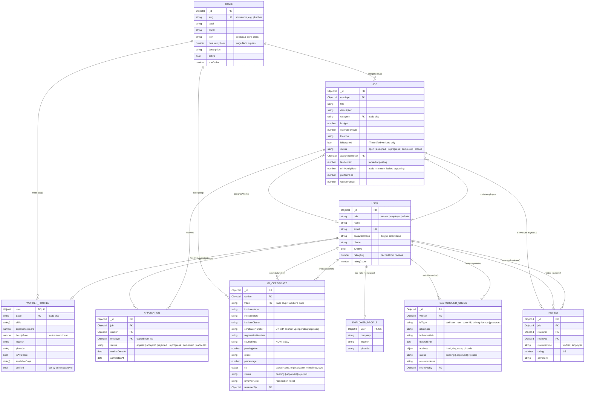

# SIMSAR — database schema

Database: **`simsar`** on a local MongoDB (`mongodb://localhost:27017/simsar`), accessed with Mongoose.
Model files live in [`server/src/models/`](../server/src/models). Run `npm run seed` and open MongoDB Compass to browse the collections.

**How trades are referenced.** Trades live in the `trades` collection. Every other collection refers to a trade by its **slug** (a lowercase string such as `"plumber"`), not by ObjectId: `workerprofiles.trade`, `jobs.category` and `iticertificates.trade`. The slug is set once when the trade is created and is `immutable` in the schema, so references never go stale. Slugs keep URLs readable (`/workers?trade=plumber`) and meant the existing data did not need migrating. `ItiCertificate` also has a Mongoose virtual `tradeInfo` (`ref: 'Trade'`, `localField: 'trade'`, `foreignField: 'slug'`) so it can be populated like an ObjectId reference.

## ER diagram



## Collections

### `trades`
The trades SIMSAR offers and each one's **fair minimum hourly rate** (the wage floor). Nothing in the code hardcodes this list; the seed script upserts the starting seven, and the admin manages them from the **Trades & Wage Rates** tab.

| Field | Type | Rules |
|---|---|---|
| slug | String | required, **unique**, lowercase, `^[a-z][a-z0-9-]{1,29}$`, **immutable** (other collections reference it) |
| label, plural | String | required, 2–40 chars (e.g. `Plumber`, `Plumbers`) |
| icon | String | Bootstrap Icons class, `^bi-[a-z0-9-]+$`, default `bi-tools` |
| minHourlyRate | Number | required, ≥ 0, rupees per hour |
| description | String | optional, ≤ 300 chars |
| active | Boolean | default true. Inactive trades are hidden from dropdowns, sign-up and new jobs, but existing workers and jobs keep them |
| sortOrder | Number | 0–999, display order |

Indexes: `slug` (unique), `{ active, sortOrder }`.
Seeded rates: Electrician 350 · Plumber 320 · Carpenter 380 · Painter 280 · Tailor 250 · AC Technician 420 · Mason 300.
A trade that any worker, job or certificate uses cannot be deleted; `DELETE /api/admin/trades/:id` deactivates it instead.

### `users`
Every account. `role` decides the dashboard and which API routes are allowed.

| Field | Type | Rules |
|---|---|---|
| role | String | required, `worker` / `employer` / `admin` |
| name | String | required, 2–80 chars |
| email | String | required, **unique**, lowercase, email format |
| passwordHash | String | required, bcrypt (10 rounds), `select: false`, stripped in `toJSON` |
| phone | String | 10-digit Indian mobile (`^[6-9]\d{9}$`) |
| isActive | Boolean | default true; admins can suspend |
| ratingAvg, ratingCount | Number | cached average of reviews received |

Indexes: `email` (unique), `{ role, createdAt }`.
Admins are only created by the seed script; `POST /api/auth/register` accepts `worker` or `employer` only.

### `workerprofiles`
One per worker (`user` is **unique**).

| Field | Type | Rules |
|---|---|---|
| trade | String | required, slug of a trade in `trades` (must be active when chosen) |
| hourlyRate | Number | required, **must be ≥ the trade's current fair minimum** (wage floor), checked whenever the trade or rate changes |
| skills, languages | [String] | max 15 skills |
| experienceYears | Number | 0–60 |
| location, pincode | String | location required; pincode 6 digits |
| isAvailable, availableDays | Boolean, [String] | "taking new jobs" switch, weekday list |
| verified | Boolean | `true` only after an admin approves a background check |

Indexes: `user` (unique), `{ trade, verified }`, `location`.

### `employerprofiles`
One per employer (`user` **unique**). `company` (optional — households hire too), `location` (required), `pincode`, `about`.

### `jobs`

| Field | Type | Rules |
|---|---|---|
| employer | ObjectId → users | required |
| title | String | 5–100 chars |
| description | String | 15–2000 chars |
| category | String | trade slug; must be an active trade when the job is posted |
| budget | Number | required, > 0, **wage floor: `workerPayout / estimatedHours ≥ trade.minHourlyRate`** (current rate, read from `trades`) |
| estimatedHours | Number | 1–200 |
| location, pincode, scheduledFor | | |
| itiRequired | Boolean | default false. "ITI-certified workers only": applying (and being accepted) needs an approved ITI certificate for `category` |
| status | String | `open` → `assigned` → `in-progress` → `completed`, or `closed` |
| assignedWorker | ObjectId → users | set when the employer accepts an application |
| feePercent | Number | copied from `PLATFORM_FEE_PERCENT` when posted, never changed afterwards |
| minHourlyRate | Number | **snapshot** of the trade's minimum when the job was posted (or last edited by the employer) |
| platformFee, workerPayout | Number | computed in a `pre('validate')` hook: `fee = round(budget × feePercent / 100)`, `payout = budget − fee` |

Indexes: `{ status, category, createdAt }`, `{ employer, createdAt }`, `location`, text index on `title + description`.

**When the wage floor is checked.** The `pre('validate')` hook reads the trade's current `minHourlyRate` when a job is created, when the employer edits it, or when `category`, `budget` or `estimatedHours` change, and stores it in `minHourlyRate`. Status changes (accept, start, complete, close) skip the check, so an admin raising a rate never breaks a job that was already posted.

### `applications`
A worker's application to a job; once accepted it is the booking.

Status flow:
```
applied ──accept──▶ accepted ──start──▶ in-progress ──(worker: done)──▶ (employer: complete) ──▶ completed
   │                   │                      │
   ├─reject─▶ rejected  └──cancel──▶ cancelled ◀┘   (cancelling a booking re-opens the job)
   └─withdraw─▶ cancelled
```
`rejected` is an extra status beyond the brief: when an employer accepts one worker, the other applicants are marked `rejected`.

Indexes: **`{ job, worker }` unique** (one application per worker per job), `{ worker, status }`, `{ employer, status }`.

### `backgroundchecks`
Simulated verification — an admin reviews the details by hand; no third-party API.

| Field | Rules |
|---|---|
| idType / idNumber | format checked per type (Aadhaar 12 digits, PAN `ABCDE1234F`, …) |
| fullNameOnId, dateOfBirth | worker must be 18+ |
| address | line1, city, state, 6-digit pincode, all required |
| consent | must be `true` |
| status | `pending` / `approved` / `rejected` |
| reviewerNotes | required when rejecting (API rule) |
| reviewedBy, reviewedAt | the admin and time |

A worker can have only one `pending` or `approved` check at a time; after a rejection they submit a new one (history is kept).
Indexes: `{ worker, createdAt }`, `{ status, createdAt }`.

### `iticertificates`
A worker's ITI (Industrial Training Institute) certificate — an **extra, optional credential**, separate from the background check. **Simulated:** a SIMSAR admin compares the typed details with the uploaded scan by hand. SIMSAR does not call the NCVT MIS portal or any state council (they offer no public verification API); the UI says "verified by SIMSAR admin against the certificate".

| Field | Rules |
|---|---|
| worker | ObjectId → users, required |
| trade | trade slug, must equal the worker's trade on SIMSAR (controller rule); virtual `tradeInfo` populates the `Trade` |
| instituteName, instituteState, instituteDistrict | required |
| certificateNumber | required; normalised (upper case, spaces/`/`/`-` removed) then `^(?=.*\d)[A-Z0-9]{8,20}$` |
| registrationNumber | optional, normalised, 6–20 letters/digits |
| councilType | `NCVT` / `SCVT` |
| passingYear | integer, 1960 – current year |
| grade, percentage | optional; percentage 0–100 |
| file | `{ storedName, originalName, mimeType, size }`. JPG/PNG/PDF, ≤ 2 MB, file signature checked. Stored in `server/uploads/iti/` (git-ignored) under a random name; served only to the owner and admins by `GET /api/iti-certificates/:id/file`. `storedName` is stripped from JSON |
| status | `pending` / `approved` / `rejected` |
| reviewerNote | **required when rejecting** (model + API rule) |
| reviewedBy, reviewedAt | the admin and time |

Indexes:
- **`{ certificateNumber, councilType }` unique, partial (`status ∈ {pending, approved}`)** — the same certificate can't be claimed by two workers. Rejected submissions are left out, so a rejected false claim never blocks the real owner and a worker can re-submit after fixing a mistake.
- `{ worker, createdAt }`, `{ worker, trade, status }`, `{ status, createdAt }`.

A worker can have one `pending` or `approved` certificate per trade; after a rejection they submit again (history is kept).

### `reviews`
Two-way rating. After a job is `completed`, the employer reviews the worker and the worker reviews the employer.

| Field | Rules |
|---|---|
| job, reviewer, reviewee | required; the server works out the reviewee from the job |
| reviewerRole | `worker` / `employer` |
| rating | integer 1–5 |
| comment | ≤ 500 chars |

Indexes: **`{ job, reviewer }` unique** — one review per party per job, enforced by MongoDB. `{ reviewee, createdAt }` for profile pages.
A `post('save')` hook recalculates the reviewee's `ratingAvg` / `ratingCount` with an aggregation.

## Business rules enforced in the database layer

| Rule | Where |
|---|---|
| Wage floor on jobs, read from `trades` | `Job` `pre('validate')` |
| Wage floor on worker rates, read from `trades` | `WorkerProfile` `pre('validate')` |
| Old jobs keep the minimum they were posted with | `jobs.minHourlyRate` snapshot |
| Fee/payout always consistent with budget | `Job` `pre('validate')` |
| Trade slugs never change | `immutable: true` on `trades.slug` |
| One certificate, one worker | partial unique index on `iticertificates` |
| Rejection needs a note | `ItiCertificate` `reviewerNote` validator |
| One application per worker per job | unique index on `applications` |
| One review per party per job | unique index on `reviews` |
| Unique email | unique index on `users` |
| Passwords never leave the server | `select: false` + `toJSON` transform |

Enforced in controllers (not the schema): ITI certificate trade must match the worker's trade; one pending/approved certificate per worker per trade; "ITI-certified only" jobs on apply and accept; trades in use are deactivated rather than deleted.
